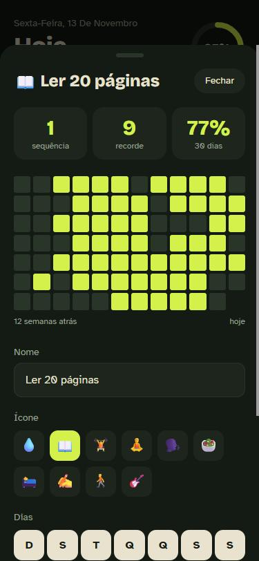

# habitflow

**PT** · App de hábitos mobile-first. Marque o dia com um toque, acompanhe sequências e veja em que dias da semana você mais cumpre o combinado. Instalável como app (PWA) e funciona sem internet.
**EN** · Mobile-first habit tracker. One tap to check in, streaks, and per-weekday stats. Installable (PWA) and works offline.

🔗 **Ao vivo / Live:** https://habitflow-vhcode.vercel.app



## Português

### Funcionalidades
- **Hoje:** hábitos agendados para o dia, anel de progresso e marcação com vibração leve
- **Sequências:** atual e recorde, respeitando os dias em que o hábito está agendado
- **Histórico:** grade das últimas 12 semanas por hábito
- **Estatísticas:** conclusão em 30 dias, desempenho por dia da semana, ranking de hábitos
- **Lembretes:** notificação local no horário escolhido (com o app aberto ou instalado)
- **PWA:** instalável no Android/iOS, offline via service worker, dados no `localStorage` do aparelho

Na primeira visita o app vem com 4 hábitos de exemplo e 10 semanas de histórico, para as estatísticas não começarem vazias.

### Stack
Vite 8 · React 19 · TypeScript · Tailwind CSS 4 · vite-plugin-pwa (Workbox) · Vitest + Testing Library

### Como rodar
```bash
npm install
npm run dev      # http://localhost:5173
npm test
npm run build && npm run preview
```

## English

### Features
- **Today:** habits due today, progress ring, one-tap check-in with haptic feedback
- **Streaks:** current and best, aware of each habit's schedule
- **History:** 12-week grid per habit
- **Stats:** 30-day completion, per-weekday performance, habit ranking
- **Reminders:** local notifications at the chosen time
- **PWA:** installable, offline-first, data stays on the device

### Stack
Vite 8 · React 19 · TypeScript · Tailwind CSS 4 · vite-plugin-pwa · Vitest + Testing Library

### Run locally
```bash
npm install
npm run dev
npm test
npm run build && npm run preview
```
